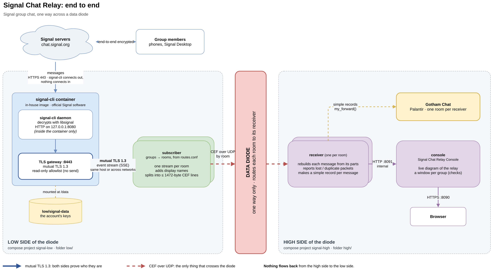
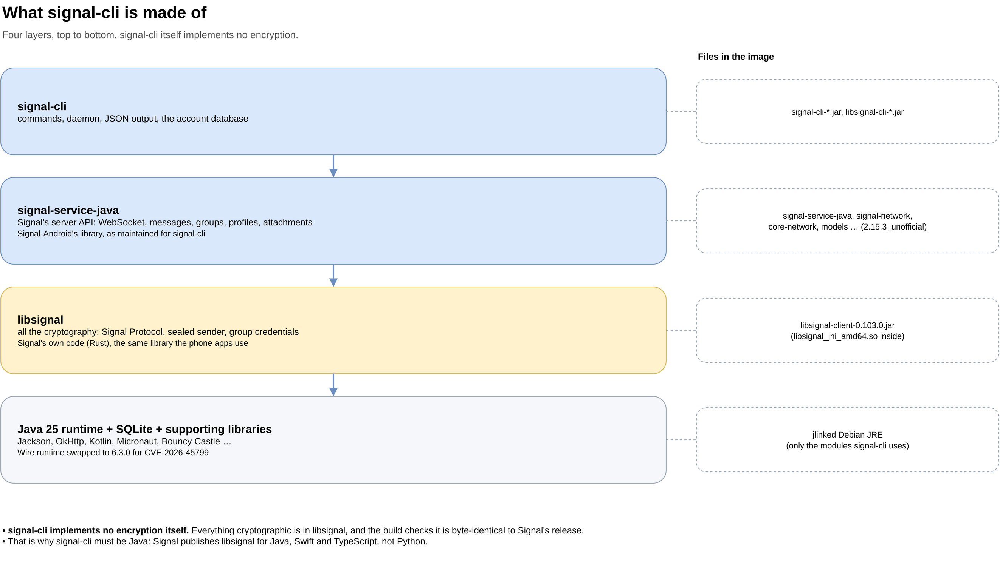
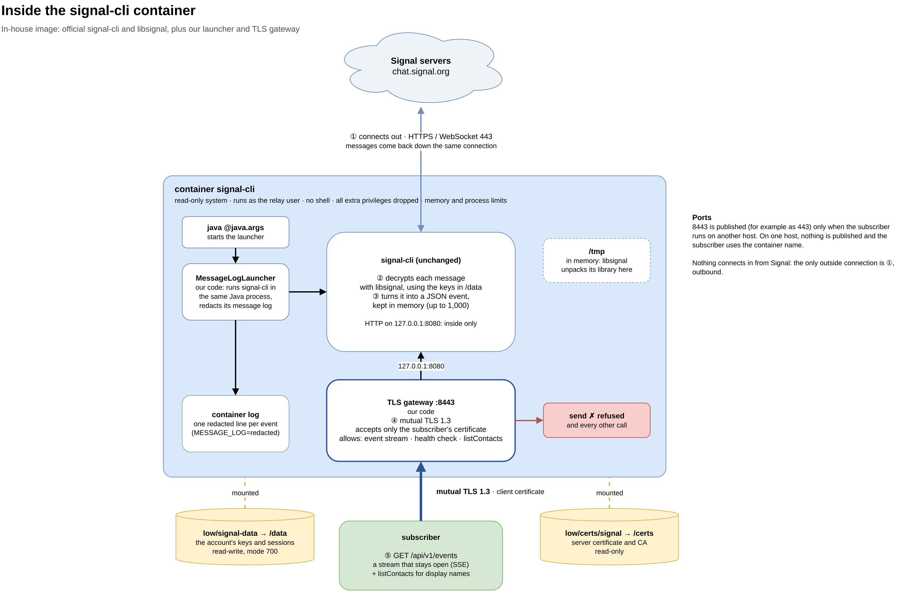
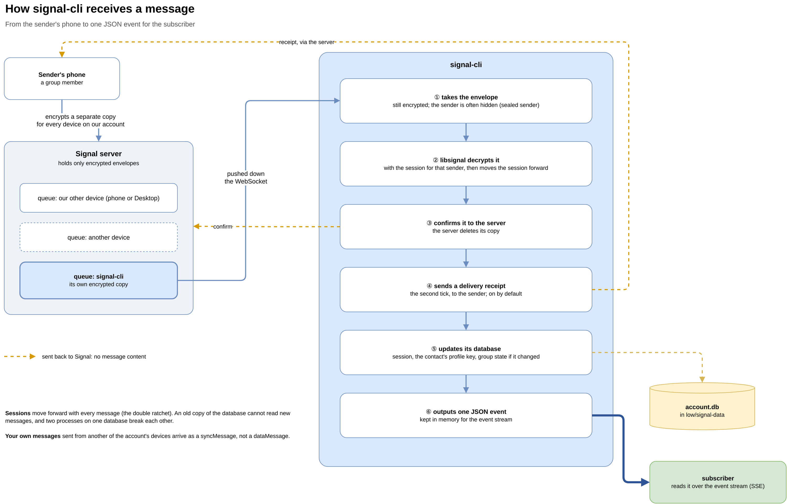
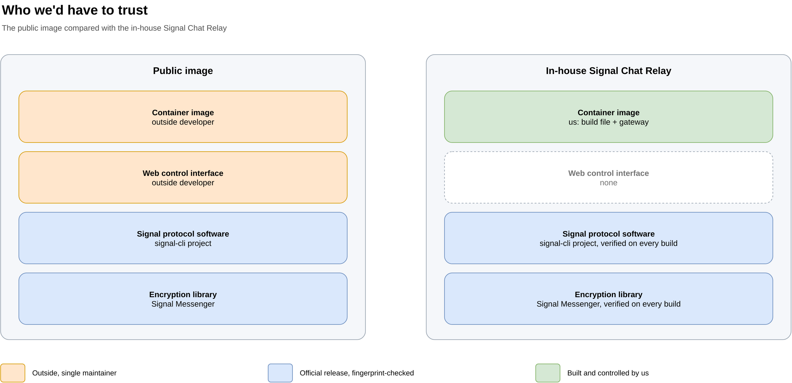
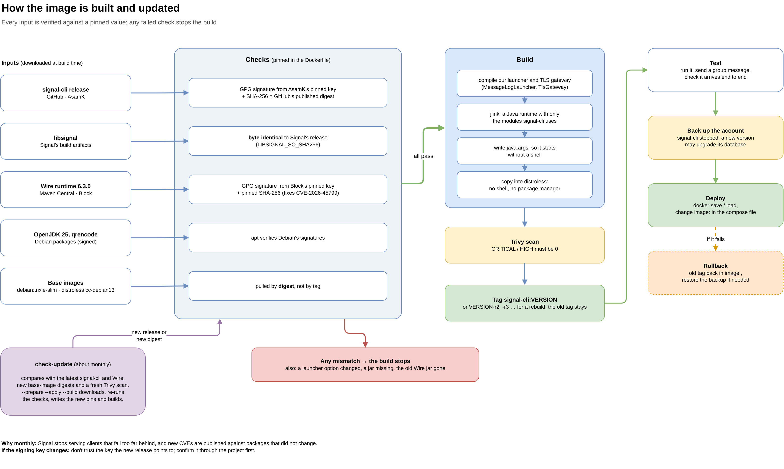

# signal-cli in the Signal Chat Relay: technical reference

*For engineers and security reviewers. Version described: signal-cli **0.14.9** in our in-house image. October 2026.*

This document describes the one part of the Signal Chat Relay that talks to Signal: **signal-cli**, running in our own
container image. It covers what signal-cli is, how it receives messages, what runs around it in the container, what
it sends back to Signal, how the image is built and kept up to date, and the licences involved.

It replaces the old `docs/signal-cli-architecture.md`. Facts about signal-cli's behaviour come from its own manual
(`man signal-cli`, `man signal-cli-jsonrpc`), which ships in the image under `/opt/signal-cli/man`. Facts about our
image come from `image/Dockerfile`, `image/launcher/` and `high/docs/image.md`.

**Out of scope:** the relay's own components after signal-cli (subscriber, receivers, the console), the delivery
platform, and step-by-step runbooks. Registering a number is in `high/docs/register-account.md`; building and updating
step by step is in `high/docs/image.md`.

The diagrams are in `high/docs/diagrams/`: each has an editable `.drawio` source, a `.pdf` and a `.png`.

---

## Contents
1. [Where signal-cli fits](#1-where-signal-cli-fits)
2. [What signal-cli is](#2-what-signal-cli-is)
3. [The account and its devices](#3-the-account-and-its-devices)
4. [Inside the container](#4-inside-the-container)
5. [How a message is received](#5-how-a-message-is-received)
6. [What goes back to Signal](#6-what-goes-back-to-signal)
7. [Trust and supply chain](#7-trust-and-supply-chain)
8. [Security controls](#8-security-controls)
9. [Operations](#9-operations)
10. [Licensing and distribution](#10-licensing-and-distribution)
11. [Appendix: glossary and versions](#11-appendix)

---

## 1. Where signal-cli fits



The relay copies Signal group chats, one way, across a data diode:
- **signal-cli** is a device on a Signal account. It receives and decrypts the group's messages.
- The **subscriber** reads them from signal-cli over a mutual-TLS link, keeps only the chosen groups, and sends each
  message as CEF over UDP to the diode.
- On the far side, the **receiver** rebuilds each message and hands it to the external platform.

signal-cli is the only component that holds the account's keys or talks to Signal. From the subscriber onward, only CEF
over UDP travels, in one direction, so nothing downstream can reach back to signal-cli or the account.

## 2. What signal-cli is

- An **unofficial, open-source Signal client** with no screen: a command line and a background service (the daemon).
  - Written by Sebastian Scheibner (AsamK) and contributors: https://github.com/AsamK/signal-cli (GPLv3, Java).
  - Signal (the company) neither makes nor supports it. In this document, "official" means AsamK's signed release.
- Built for servers: alerts, bots and relays like ours. The public `bbernhard/signal-cli-rest-api` image, which the
  relay used before, is a wrapper around it.
- To Signal's servers it is simply another device on the account, like a phone or Signal Desktop.



- **signal-cli implements no encryption itself.** All cryptography is in **libsignal**, Signal's own library and the
  same one the phone apps use. Our build checks that it is byte-identical to Signal's release (section 7).
- **signal-service-java** knows Signal's server API. Its version tag says "unofficial" because it is the
  signal-cli-maintained build of Signal-Android's library.
- signal-cli has to be **Java**: Signal publishes libsignal for Java, Swift and TypeScript, not Python.
- **What it handles:** text, attachments, reactions, edits, deletes, groups and receipts. Not voice or video calls.

## 3. The account and its devices

### The account is a folder
Everything that makes this device *this device* is in one data folder, mounted at `/data` in the container:
```
data/
├─ accounts.json        which accounts are in the folder
├─ <id>                 the account file: number, device id, password, identity and profile keys
└─ <id>.d/
   ├─ account.db        SQLite: sessions, pre-keys, contacts, groups
   └─ storage-manifest  state of the account's encrypted storage on Signal's servers
```
- **Copying the folder copies the device. Losing it loses the device.** Keep it mode 700, owned by the container's
  user, and back it up only with signal-cli stopped, so the database is consistent.
- **The database changes with every message:** encryption sessions move forward each time (section 5). So **two
  signal-cli processes must never use the same folder.** They would both move the same sessions and break them.
  signal-cli locks the account to prevent this, which is why the daemon is stopped before any one-off command.
- An old copy can't read new messages. Restoring a backup means some conversations re-establish their sessions.

### Main device or linked device
- **Main device:** created with `register` and `verify`, using the number and an SMS or voice code, usually with a
  captcha. signal-cli then takes the place of a phone. This is the setup for a **service account**, such as a
  landline number that no phone uses.
- **Linked device:** created with `link`. The main device scans a QR code, as for Signal Desktop. It receives
  messages from the moment it is linked, never earlier history. Signal removes linked devices that stay offline
  for about 30 days.
- A main device can link others itself: `addDevice --uri 'sgnl://linkdevice?…'`.

### One queue per device
Signal keeps a **separate message queue for each device** on the account, and every device gets its own encrypted
copy. signal-cli, a phone and Signal Desktop on the same account don't take messages from each other.

### Groups
- A group's state (name, members, admins, settings) is stored **encrypted on Signal's servers**. Each member device
  holds the group's master key; the server can't read the name or the member list.
- Group membership belongs to the **account**, not to a device. A group joined from Signal Desktop is a group that
  signal-cli receives too.
- In events, `groupInfo.groupId` is the group's internal ID, a base64 string ending in `=`. The relay filters on it.

### Registration lock
A PIN set with `set-pin` stops anyone else from registering the number. The lock lapses after 7 days of
inactivity, so signal-cli should keep running. Signal also deletes accounts that stay offline for months.

## 4. Inside the container



### The base
- Google's **distroless** `cc-debian13`: glibc, libstdc++, zlib and CA certificates. **No shell and no package
  manager.** 193 MB in total.
- A **Java 25 runtime** built with `jlink` from Debian's OpenJDK, with only the modules signal-cli uses.
- `qrencode`, for link QR codes.
- Alpine was tested and rejected: Signal publishes libsignal only for glibc, and it fails to load on Alpine even with
  `gcompat`. Using Alpine would mean compiling libsignal ourselves, which loses the byte-identical check.

### Start-up
The image starts `java @/opt/signal-cli/java.args`: the official launcher's class path and Java options, written out
at build time so no shell is needed. That starts our **MessageLogLauncher**, which runs signal-cli's own `Main`,
unchanged, in the same process.

### The daemon
The relay runs signal-cli as a daemon with an HTTP service on `127.0.0.1:8080`, reachable only inside the container:
```
-a <number> daemon --http 127.0.0.1:8080 --receive-mode on-start
           --ignore-attachments --ignore-stories --ignore-avatars --ignore-stickers
```
- `--receive-mode on-start` starts receiving straight away, without waiting for a client.
- The `--ignore` options stop downloads of files, stories, avatars and stickers. Events still say an attachment exists.

| Endpoint | What it does |
|---|---|
| `GET /api/v1/events` | **Server-Sent Events** stream of incoming messages. Stays open. |
| `POST /api/v1/rpc` | JSON-RPC: the same commands as the command line (`listContacts`, `send` …). |
| `GET /api/v1/check` | 200 OK while the daemon is running. |

signal-cli's HTTP service has **no encryption and no login**. That's why it listens only on `127.0.0.1` and is never
published. The only way in is our gateway.

### Message log (MessageLogLauncher)
signal-cli normally prints every received message, **including its text**, to its log. The launcher replaces that:

| `MESSAGE_LOG` | The container log shows |
|---|---|
| `redacted` (default) | One plain-English line per event: kind, shortened sender number, device, group, time. Content is hidden; only its length or count is shown. |
| `full` | signal-cli's normal output, including text. For troubleshooting only. |
| `off` | Nothing. |

- Hidden in `redacted`: message and edit text, quotes, captions, stories, polls, contact cards, link previews, file
  names, payments, and **any field the launcher doesn't recognise**. So anything new in a future signal-cli is
  hidden by default.
- It works on signal-cli's JSON output (`-o json`), one event per line, so a multi-line message can't slip past.

### TLS gateway (TlsGateway)
With `TLS_LISTEN` set, the launcher puts a mutual-TLS front end on port 8443 in front of the daemon:
- **TLS 1.3 only.** The client must present a certificate signed by our own CA, with an allowed name (default
  `signal-subscriber`). Anything else is refused during the handshake.
- **Read-only allowlist:** `GET /api/v1/events`, `GET /api/v1/check`, and `POST /api/v1/rpc` only for methods in
  `RPC_ALLOW` (default `listContacts`). Everything else, **including `send`**, gets 403, even with a valid certificate.
- **Request handling:** requests are rebuilt from a short header list, one request per connection, no chunked bodies
  (so a second request can't be smuggled in), bodies up to 64 KB, at most 32 open connections.
- **Fails closed:** if the certificates can't be loaded, or the daemon isn't on `127.0.0.1`, the container stops. It
  never falls back to plain HTTP.
- Its logs never include message content.
- Tested refusals: no certificate, a certificate from another CA, the server's own certificate used as a client,
  TLS 1.2, `send`, batches, chunked bodies, other paths, and a smuggled second request.

### Container settings
- Runs as a regular user, not root, with a **read-only filesystem**, all Linux capabilities dropped,
  `no-new-privileges`, and memory and process limits.
- `--init`, so stop signals reach Java.
- `/tmp` is an in-memory filesystem with `exec`. libsignal unpacks its native library there (about 200 MB) at every
  start and loads it from there. Docker's default `noexec` would fail with *failed to map segment from shared object*.
- Mounts: the account folder at `/data` (read-write) and the certificates at `/certs` (read-only).
- No port is published when the subscriber runs on the same host. When it runs elsewhere, only the gateway port is
  published.

## 5. How a message is received



1. The sender's phone **encrypts a separate copy for every device** on our account. Signal's server queues each one.
2. signal-cli keeps a **WebSocket** open to Signal (outbound, HTTPS port 443). The server pushes the envelope down it.
   The envelope is still encrypted, and with *sealed sender* even the sender is hidden from the server.
3. **libsignal decrypts it** with the session for that sender, then moves the session forward (the *double ratchet*).
4. signal-cli **confirms** it to the server, which deletes its copy.
5. It **sends a delivery receipt** to the sender: the second tick. This is on by default (section 6).
6. It **updates its database:** the session, the contact's profile key, and group state if it changed.
7. It **outputs one JSON event**, kept in memory for the event stream.

### The event stream
- Each event has an **id**. signal-cli keeps the **last 1,000 events in memory**.
- A client that reconnects with a `Last-Event-ID` header gets the events after that id. The relay's subscriber saves
  the id, so a dropped connection loses nothing.
- If the id is unknown, for example because signal-cli restarted, **all kept events are sent again**.
- Keep-alive messages every 15 seconds let signal-cli notice a client has gone.

### What an event looks like (trimmed)
```json
{"envelope": {
   "sourceName": "…", "sourceUuid": "…", "sourceDevice": 1,
   "timestamp": 1791514641191, "serverReceivedTimestamp": 1791514641402,
   "dataMessage": {
     "message": "…text…",
     "groupInfo": {"groupId": "…=", "groupName": "…", "type": "DELIVER"},
     "mentions": [], "quote": {…}
   }},
 "account": "+1…"}
```
- Other kinds use other keys in `envelope`: `syncMessage`, `receiptMessage`, `typingMessage`, `editMessage`, and
  reactions inside `dataMessage`.
- **Messages sent from the account's own other devices** (for example, Signal Desktop on the same account) arrive as
  `syncMessage.sentMessage`, not `dataMessage`.
- **Two timestamps:** `timestamp` comes from the *sender's* device clock and is Signal's key for the message: replies,
  reactions and edits refer to it. `serverReceivedTimestamp` is Signal's server clock. A device with a wrong clock
  gives wrong `timestamp`s, so for ordering and display use the server time, and keep `timestamp` for matching.

### Trust on first use
The first identity key seen for a person is trusted automatically (`--trust-new-identities on-first-use`, the
default). If a person's key later changes, for example after a new phone, it must be accepted with `trust`. If one
member's messages stop arriving after they change phones, check this first.

## 6. What goes back to Signal

The relay is one-way across the diode, but signal-cli, like every Signal device, talks both ways with Signal:

| Sent to Signal | When | Can we stop it? |
|---|---|---|
| Confirmation to the server | every message received | No. Without it the server keeps re-sending. |
| **Delivery receipt** (second tick) to the sender | every message, **by default** | Not with an option in 0.14.9. |
| Read receipts | only with `--send-read-receipts` | We don't use it. |
| Pre-key top-ups, profile and group fetches | as needed | No. Part of being a device. |
| Messages | only if someone calls `send` | **Yes.** The gateway allows only `listContacts`. |

**Group members see that the relay's device received their message. Nothing they wrote is ever answered, and no
content goes back.**

All of this uses the one outbound connection on port 443. signal-cli connects out; nothing connects in from Signal.
TLS to Signal is checked against certificates **pinned inside signal-cli**, so certificate checking can't be turned off.

## 7. Trust and supply chain



The public image needed trust in an outside, single-maintainer image and web control interface. The in-house image
contains only the official signal-cli release and Signal's own libsignal, both verified on every build, plus our
small launcher and gateway. There is no web control interface.



### What the build checks (any failure stops it)
1. **signal-cli release:** a good GPG signature from AsamK's key (fingerprint pinned, key kept in the repo), and a
   SHA-256 matching the digest GitHub publishes for the release.
2. **libsignal:** `libsignal_jni_amd64.so` must be **byte-identical** to Signal's own libsignal-client release of that
   version. The macOS and Windows copies are removed.
3. **Wire runtime patch:** signal-cli 0.14.9 bundles `wire-runtime-jvm 6.0.0-alpha02`, affected by **CVE-2026-45799**
   (HIGH: a crafted protobuf can crash message decoding). The build swaps in 6.3.0 from Maven Central, checked
   against Block's pinned signing key and a pinned SHA-256. If a future signal-cli no longer bundles the old jar,
   the build stops so the swap can be reviewed or removed.
4. **Start-up options:** if the official launcher's Java options change, or a jar is missing, the build stops.
5. **Debian packages** (OpenJDK, qrencode) are verified by apt's signature checks.
6. **Base images are pinned by digest,** not by tag: `debian:trixie-slim` for the build stage and distroless
   `cc-debian13` for the runtime.

After the build, a **Trivy scan** must show no CRITICAL or HIGH findings. At the scan of 11 October 2026: 0 critical, 0 high; the
remaining medium and low findings are all in glibc, gcc and zlib, with no fix released.

### Keeping it current
- **Run `image/check-update` about monthly.** Signal stops serving clients that fall too far behind (roughly a few
  months), and new CVEs appear in packages that haven't changed.
- It compares the pinned versions with the latest signal-cli and Wire, checks for new base-image digests, and
  re-scans the running image.
- `--prepare --apply --build` downloads the new release, re-runs every check, writes the new pinned values and builds
  `signal-cli:VERSION`, or `VERSION-r2` for a rebuild of the same version, so the old tag stays for rollback.
- **If the signing key changes,** don't trust whatever key the new release points to. Confirm it through the project
  itself first.

## 8. Security controls

| Area | Control |
|---|---|
| **Inputs** | Every component verified against pinned signatures and hashes; libsignal byte-identical to Signal's. |
| **Versions** | Everything pinned, including base images by digest. Nothing changes without a reviewed rebuild. |
| **Vulnerabilities** | Trivy on every build and monthly; a known HIGH in a bundled library patched (Wire). |
| **Attack surface** | No shell, no package manager, no web interface, no device linking over the network. |
| **Network in** | signal-cli's own HTTP service only on `127.0.0.1`. The only entry point is the mutual-TLS gateway. |
| **Network out** | One outbound connection to Signal on port 443, certificates pinned. |
| **Who can connect** | Only clients holding a certificate from our CA with an allowed name. |
| **What they can do** | Read only: event stream, health check, `listContacts`. `send` and all else refused. |
| **Container** | Non-root user, read-only filesystem, no capabilities, `no-new-privileges`, memory and process limits. |
| **Logs** | Message content redacted by default; unknown fields hidden. |
| **Account keys** | One folder, mode 700, mounted only into this container; encrypted backups kept off the host. |

**What it doesn't protect against:** someone with control of the host can read the account folder, and anything
running as the container's user can read the keys. Protect the host and that user accordingly.

## 9. Operations

- **Health:** `GET /api/v1/check` through the gateway; the container log shows start-up, the stream opening for the
  subscriber, and one line per event.
- **Restarts:** safe. On reconnect the subscriber resumes from its saved event id.
- **The loss case:** the 1,000 kept events are in memory only, and signal-cli has already confirmed them to Signal.
  Messages that arrive while the subscriber is down are lost **if signal-cli also restarts** before the subscriber
  reconnects.
- **One-off commands** (`listGroups`, `addDevice` …): stop the daemon first, run the command in a throwaway container
  with the same data folder, then start the daemon again. Messages wait on Signal's servers meanwhile. Our
  `image/signalctl` does this.
- **No shell for troubleshooting:** `docker exec … sh` won't work. Use the container log, `docker cp` or `signalctl`.
- **Backups:** with signal-cli stopped, encrypted, and kept off the host. Back up again just before every update,
  because a new version may upgrade the database and an older one may then refuse it.
- **Updates and rollback:** section 7, and step by step in `high/docs/image.md`.
- **Rate limits and captchas** apply as for any phone, mainly when registering or sending a lot.

## 10. Licensing and distribution

*This is our reading of the licences, not legal advice.*

| Component | Licence |
|---|---|
| signal-cli | GPLv3 |
| libsignal | AGPLv3 |
| OpenJDK runtime | GPLv2 with the Classpath Exception |
| Wire, Jackson and most other Java libraries | Apache 2.0 |
| qrencode | LGPL 2.1 |
| libpng | libpng licence (permissive) |
| Distroless base (Debian packages) | various; notices in `/usr/share/doc` |
| Our launcher and gateway | runs in the same Java process as signal-cli, so it forms part of a GPLv3 work |

**Using the image internally** carries no conditions. **Giving the image to anyone else**, including publishing it
to a public registry, is distribution, and then:
1. **Offer the corresponding source.** The Dockerfile and launcher are in the repo; the signal-cli and libsignal
   source for the exact versions should be published alongside the image, not only linked upstream.
2. **License our launcher and gateway under GPLv3.**
3. **Include the licence texts.** The image has OpenJDK's (`/opt/java/legal`) and the Debian base packages'. It
   currently **lacks** signal-cli's own licence and the qrencode and libpng notices.
4. **Don't present it as official.** "Signal" is a trademark: describe the image as an unofficial build of signal-cli.

## 11. Appendix

### Glossary
- **Main device / linked device:** the device that registered the number, and the extra devices it approved.
- **Sealed sender:** Signal hides who sent a message from its own servers; only the recipient's device sees it.
- **Double ratchet:** the Signal Protocol's way of moving keys forward with every message, so an old key can't read
  new messages.
- **Pre-keys:** one-time keys a device publishes so others can start a session with it while it is offline.
- **Registration lock:** a PIN that must be given to register the number again.
- **WebSocket:** a two-way connection that stays open. signal-cli uses one to Signal.
- **SSE (Server-Sent Events):** a one-way stream over HTTP that stays open, with an id per event so a client can
  resume. signal-cli serves one to the subscriber.
- **Mutual TLS:** both sides present certificates, so each proves who it is.
- **CEF:** Common Event Format, the line format the relay uses across the diode.

### Versions in the image

| Component | Version |
|---|---|
| signal-cli | 0.14.9 |
| libsignal-client | 0.103.0 |
| signal-service-java | 2.15.3_unofficial |
| Wire runtime | 6.3.0 (replacing 6.0.0-alpha02) |
| Java | OpenJDK 25 (Debian), jlinked |
| Base images | `debian:trixie-slim` (build), `gcr.io/distroless/cc-debian13` (runtime), both pinned by digest |
| Image size | 193 MB |

### Related documents
- `high/docs/image.md`: building, scanning, `signalctl`, the gateway's settings, and updating step by step.
- `high/docs/register-account.md`: registering a new number as a service account.
- `high/docs/public-image-assessment.md` and `high/docs/in-house-proposal.md`: why the public image was replaced.
- `high/docs/diagrams/`: all diagrams, with editable sources.
